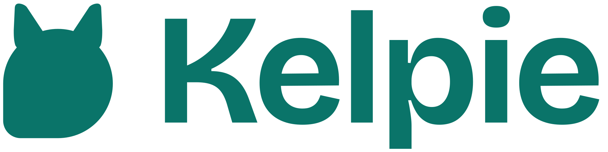

<h1>
  <picture>
    <source media="(prefers-color-scheme: dark)" srcset="docs/brand/kelpie-lockup-dark.svg">
    
  </picture>
</h1>

> Herds your AI agents across every channel, at the edge.

Kelpie is a self-hosted, multi-agent AI assistant harness that connects chat channels (WhatsApp, Telegram, Discord, Slack and a web chat) to large language models. It runs on Cloudflare's developer platform (Workers, Durable Objects, Queues and Workflows), event-driven, so it starts cheap and scales. When an agent needs a real machine, for coding with Claude Code among other things, it uses a Cloudflare Sandbox or the owner's own server, only once the owner turns that on ([ADR-0035](docs/adr/0035-agent-computer.md)). One instance serves one owner, a person or a team; each agent works like an extra colleague.

> **Status: Phase 2, memory and tools (release 0.2).** Merges into `main` run CI only. Production ships from a published release, when the owner asks for it: the six Workers deploy, production is watched, and an unhealthy release rolls back by itself ([deploying and rolling back](docs/deploy.md)). Every workspace keeps at least 80% test coverage ([testing](docs/testing.md)). Start with the [viability study](docs/viability-study.md); the work is tracked on the [project board](https://github.com/users/guedesdiogo/projects/1).

## Goals

- **Human-paced conversations, when you want them.** Buffer fragmented user messages before calling the model, and deliver one model reply as several paced messages with a typing indicator where the channel supports it. Each agent can switch this mode on or off.
- **Memory that compounds.** Agent persona, skills, learnings and memories live as versioned Markdown files in the owner's own git repository, which people and other agents can read and edit ([ADR-0020](docs/adr/0020-shared-memory-engine.md)). That includes what agents learn about other people. Kelpie is meant for personal use. Erasing someone's data means rewriting git history, and that, like compliance with privacy law, is the responsibility of whoever runs the instance.
- **Tools from anywhere.** Remote MCP servers and Composio behind a single tool interface.
- **A qualifier layer.** Typed decisions (which tool, which skill, which memories) go through Jev, TypeSafe AI's decision model, with a fallback that needs no API key.
- **More than one model provider.** Anthropic and OpenAI first, behind a provider interface that leaves room for others.
- **Many agents, closed doors.** Agents that orchestrate other agents and agents with no channel at all. Only users configured in advance, on channel identities enabled for them, can talk to the agents they have been granted. For now Kelpie is single-user: only the owner talks to the agents, and multi-user has no date yet ([ADR-0015](docs/adr/0015-single-player-first.md)).
- **Pluggable connectors.** Postgres providers, Jev access paths, model providers, channels and tool sources sit behind interfaces, so adding another provider is configuration plus one adapter.

## Why "Kelpie"

The Australian kelpie is a herding dog that works on its own, far from its handler, and learns its commands: Kelpie runs agents across channels at the edge and learns skills from conversations. In Celtic folklore a kelpie is a shape-shifting spirit, which suits one harness wearing many agent personas.

## License

Kelpie is released under the [MIT License](LICENSE).
